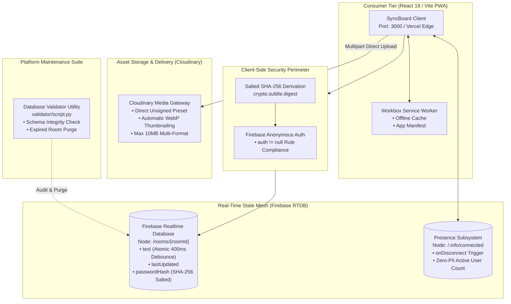

# SyncBoard Workspace

[](https://react.dev)
[](https://vitejs.dev)
[](https://mui.com)
[](https://firebase.google.com)
[](https://cloudinary.com)
[](https://web.dev/progressive-web-apps/)
[](https://prismjs.com)
[](LICENSE)

A high-performance, **zero-account real-time collaboration workspace and PWA clipboard**, engineered for frictionless text, code, and asset synchronization across devices. Powered by **React 19**, **Vite 7**, **Firebase Realtime Database**, and **Cloudinary CDN**, the platform coordinates **400ms atomic debouncing**, **salted SHA-256 room cryptographic locking**, ephemeral self-destruct timers, and offline-first PWA caching without collecting any personally identifiable information (Zero-PII).

---

## Key Architecture Pillars

- **Atomic Debounced Synchronization (`src/services/firebaseService.js`):**
  400ms atomic debounce engine writing directly to isolated Firebase `/rooms/{roomId}/text` paths, guaranteeing database stability and zero input lag under typing bursts.
- **Zero-PII Presence & Obfuscated History (`src/hooks/` & `src/utils/`):**
  Tracks live collaborator presence via Firebase `.info/connected` and `onDisconnect` triggers without capturing IP addresses, storing the last 5 accessed boards in Base64-obfuscated local storage.
- **Cryptographic Salted SHA-256 Room Locking (`src/components/features/PinModal.jsx`):**
  Enforces room read/write isolation using Web Crypto API SHA-256 derivation salted with the room code ($H = \text{SHA-256}(\text{RoomCode} \parallel \text{PIN})$), placing unauthenticated guests in strict read-only mode.
- **Ephemeral Lifecycle & Self-Destruct Automation (`src/components/features/SelfDestructTimer.jsx`):**
  Configurable board lifetimes (10 minutes, 1 hour, 24 hours) verified and purged upon expiration directly from the client and backend validation scripts.
- **Heuristic Multi-Language Syntax Detection (`src/hooks/useLanguageDetection.js`):**
  In-memory regex pattern scoring engine identifying 15+ programming languages dynamically and formatting code via PrismJS without UI thread blocking.
- **Offline PWA Architecture & Asset Pipeline (`vite.config.js`):**
  Fully installable PWA utilizing Workbox service workers with offline fallback pages, paired with Cloudinary CDN direct unsigned asset uploads up to 10MB.

---

## System Architecture



---

## Cryptographic Salt & Debounce Invariants

SyncBoard enforces strict user anonymity and cryptographic room boundaries without server-side user tables:

$$H_{\text{room}} = \operatorname{SHA-256}(\text{RoomCode}_{5\text{-char}} \parallel \text{PIN}_{6\text{-digit}})$$

$$T_{\text{debounce}} = 400\text{ms} \implies \text{Max Database Write Rate} = 2.5 \text{ ops/sec per user}$$

| Security Invariant | Technical Implementation | Privacy Guarantee |
| :--- | :--- | :--- |
| **Room Code Space** | 5-character alphanumeric ($[A-Z0-9]^5 \approx 60.4\text{M}$ rooms) | Frictionless sharing with bounded collision space |
| **Salted PIN Lock** | `SHA-256(code + ":" + pin)` | Rainbow table immune; client enforces read-only mode |
| **Anonymous Session** | Firebase Anonymous Token | Database rules require authentication without identity tracking |
| **Zero-PII Presence** | Temporary session UUIDs | IP addresses and geolocation are never collected |
| **Ephemeral Destruction**| Timestamp verification upon read | Expired records purged permanently from database |

---

## Quickstart & Platform Orchestration

### Prerequisites
- Node.js 18.0+ & npm 9+
- Firebase Project with Realtime Database enabled ([Firebase Console](https://console.firebase.google.com))
- Cloudinary Account for file uploads ([Cloudinary Free Tier](https://cloudinary.com))
- Python 3.8+ (Optional, for database maintenance utilities)

---

### Option A: Local Development Launch (Recommended)

Run the full platform locally with live Vite hot-reloading:
```bash
# Clone repository
git clone https://github.com/i-viki/sync-board.git
cd SyncBoard

# Install dependencies
npm install

# Configure environment secrets
cp example.env .env
# Edit .env with your Firebase and Cloudinary credentials

# Launch dev server
npm run dev
```
*Application available immediately at `http://localhost:3000`.*

---

### Option B: Production Build & Local Preview

```bash
# Compile optimized production bundle with PWA assets
npm run build

# Preview production build locally
npm run preview
```

---

## Decoupled Environment Strategy

All credentials and API keys are abstracted into environment templates loaded at build time:

| Service / Layer | Config File | Template Reference | Key Variables |
| :--- | :--- | :--- | :--- |
| **Firebase Realtime DB** | `src/config/firebase.js` | [`example.env`](example.env) | `VITE_APP_APIKEY`, `VITE_APP_DATABASEURL`, `VITE_APP_PROJECTID` |
| **Cloudinary CDN** | `src/services/cloudinaryService.js` | [`example.env`](example.env) | `VITE_APP_CLOUDINARY_CLOUD_NAME`, `VITE_APP_CLOUDINARY_CLOUD_UPLOAD_PRESET_NAME` |
| **Email Feedback** | `src/components/common/Feedback.jsx` | [`example.env`](example.env) | `VITE_APP_EMAILJSAPIKEY`, `VITE_APP_EMAILJSSERVICE_KEY` |
| **PWA & Offline** | `vite.config.js` | [Default Manifest] | Workbox precache manifest, runtime caching rules |

---

## Live Telemetry & Observability Hubs

| Hub / Service | Port | URL | Role & Live Features |
| :--- | :--- | :--- | :--- |
| **SyncBoard Web App** | `3000` | [http://localhost:3000](http://localhost:3000) | Core collaboration workspace, real-time board editor & QR sharing. |
| **Production Deployment**| Cloud | [https://isyncboard.vercel.app](https://isyncboard.vercel.app) | Production Vercel Edge deployment. |
| **Firebase RTDB Console**| Cloud | [Firebase Console](https://console.firebase.google.com) | Realtime JSON tree monitoring and rule verification. |

---

## Testing & Quality Assurance Suite

### Code Quality & Linter
```bash
npm run lint
# Executes ESLint across all React JSX and utility modules.
```

### Database Validator & Schema Audit Utility (Python 3)
```bash
python validator/script.py
# Audits Realtime Database JSON exports, validates room schemas, and archives corrupt nodes.
```

---

## Author

**Jayavignesh**
- **Website:** [jayavignesh.dev](https://jayavignesh.dev)
- **GitHub:** [@i-viki](https://github.com/i-viki)
- **Email:** [hello@jayavignesh.dev](mailto:hello@jayavignesh.dev)

---

## License

This platform is distributed under the **MIT License**. See the [`LICENSE`](LICENSE) file for complete terms.
