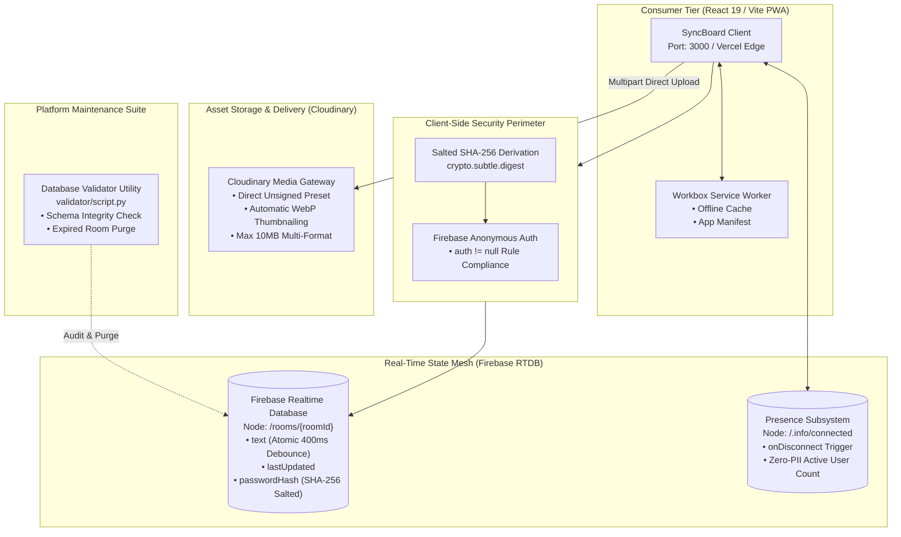

# SyncBoard Workspace

[](https://react.dev)
[](https://vitejs.dev)
[](https://mui.com)
[](https://firebase.google.com)
[](https://cloudinary.com)
[](https://web.dev/progressive-web-apps/)
[](https://prismjs.com)
[](#cryptographic-salt--debounce-invariants)
[](package.json)
[](LICENSE)

A high-performance, **zero-account real-time collaboration workspace and PWA clipboard**, engineered for frictionless text, code, and asset synchronization across devices. Powered by **React 19**, **Vite 7**, **Firebase Realtime Database**, and **Cloudinary CDN**, the platform coordinates **400ms atomic debouncing**, **salted SHA-256 room cryptographic locking**, ephemeral self-destruct timers, and offline-first PWA caching without collecting any personally identifiable information (Zero-PII).

---

## Key Architecture Pillars

- **Atomic Debounced Synchronization (`src/services/firebaseService.js`):**
  400ms atomic debounce engine writing directly to isolated Firebase `/rooms/{roomId}/text` paths, guaranteeing database stability and zero input lag under typing bursts.
- **Zero-PII Presence & Obfuscated History (`src/hooks/` & `src/utils/`):**
  Tracks live collaborator presence via Firebase `.info/connected` and `onDisconnect` triggers without capturing IP addresses, storing the last 5 accessed boards in Base64-obfuscated local storage (`btoa`), paired with dynamic SVG/Canvas QR code generation (`qrcode.react`).
- **Cryptographic Salted SHA-256 Room Locking (`src/components/features/PinModal.jsx`):**
  Enforces room read/write isolation using Web Crypto API SHA-256 derivation salted with the room code ($H = \text{SHA-256}(\text{RoomCode} \parallel \text{PIN})$), placing unauthenticated guests in strict read-only mode.
- **Universal Multi-Format File Gallery (`src/components/features/FilePanel.jsx`):**
  Allows sharing up to 5 multi-format assets simultaneously (Images, PDFs, Documents, Videos, Audio, and Code files up to 10MB each) via Cloudinary unsigned presets with automated image thumbnail optimization (`c_thumb,w_96,h_96,q_auto,f_auto`) and direct fetch-based blob download streaming.
- **Ephemeral Lifecycle & Self-Destruct Automation (`src/components/features/SelfDestructTimer.jsx`):**
  Configurable board lifetimes (10 minutes, 1 hour, 24 hours) verified and purged upon expiration directly from the client and backend validation scripts, with live minute-by-minute countdown chips.
- **Heuristic Multi-Language Syntax Detection (`src/hooks/useLanguageDetection.js`):**
  In-memory regex pattern scoring engine identifying 15+ programming languages dynamically (JavaScript, Python, Java, C++, Go, PHP, SQL, HTML, CSS, JSON, YAML, Ruby, Markdown) and formatting code via PrismJS without UI thread blocking.
- **Offline PWA Architecture & Asset Pipeline (`vite.config.js`):**
  Fully installable PWA utilizing Workbox service workers with offline fallback pages, real-time connectivity listeners (`navigator.onLine`), and stable layout geometry (`scrollbar-gutter: stable`).

---

## System Architecture



### Monorepo Structure

```text
SyncBoard/
├── public/                       # Static assets and PWA configuration
│   ├── assets/                   # App icons, avatars, and illustrations
│   ├── favicon/                  # Cross-platform icons and PWA assets
│   ├── _redirects                # SPA routing rewrites
│   ├── offline.html              # PWA offline fallback page
│   ├── robots.txt                # Search engine crawler policies
│   └── sitemap.xml               # Production SEO sitemap
├── src/
│   ├── components/
│   │   ├── common/               # Navbar, ClipNavbar, Footer, QRCodeModal
│   │   └── features/             # TextEditor, FilePanel, Hero, SelfDestructTimer, PinModal
│   ├── config/                   # Central configuration (firebase.js)
│   ├── constants/                # Static data (developers.js, faqs.js, termsContent.js)
│   ├── hooks/                    # Reusable React hooks (useLanguageDetection.js, usePresence.js)
│   ├── pages/                    # Route pages (Home, Clipboard, Explore, Feedback, Privacy, Terms)
│   ├── services/                 # firebaseService, cloudinaryService, analyticsService, authService
│   ├── utils/                    # sanitize.js, userIdentifier.js
│   ├── App.css                   # App layout styles
│   ├── App.jsx                   # Route configurations and code splitting
│   ├── index.css                 # Global theme variables, typography, and scrollbar styles
│   ├── main.jsx                  # React DOM entry point, MUI ThemeProvider
│   └── prism.css                 # PrismJS syntax highlighting theme
├── validator/                    # Maintenance & data integrity tooling
│   └── script.py                 # Python validator & archiver for Firebase RTDB exports
├── package.json                  # Dependencies and build scripts
├── example.env                   # Template for environment configuration
└── vite.config.js                # Vite build, PWA plugin, and manual chunking rules
```

---

## Cryptographic Salt & Debounce Invariants

SyncBoard enforces strict user anonymity and cryptographic room boundaries without server-side user tables:

$$H_{\text{room}} = \operatorname{SHA-256}(\text{RoomCode}_{5\text{-char}} \parallel \text{PIN}_{6\text{-digit}})$$

$$T_{\text{debounce}} = 400\text{ms} \implies \text{Max Database Write Rate} = 2.5 \text{ ops/sec per user}$$

| Security Invariant | Technical Implementation | Privacy Guarantee |
| :--- | :--- | :--- |
| **Room Code Space** | 5-character alphanumeric ($[A-Z0-9]^5 \approx 60.4\text{M}$ rooms) | Frictionless sharing with bounded collision space |
| **Salted PIN Lock** | `SHA-256(code + ":" + pin)` | Rainbow table immune; client enforces read-only mode |
| **Anonymous Session** | Firebase Anonymous Token | Database rules require authentication without identity tracking |
| **Zero-PII Presence** | Temporary session UUIDs | IP addresses and geolocation are never collected |
| **Ephemeral Destruction**| Timestamp verification upon read | Expired records purged permanently from database |

### Firebase Realtime Database Security Rules

```json
{
  "rules": {
    "rooms": {
      "$roomId": {
        ".read": "auth != null",
        ".write": "auth != null"
      }
    }
  }
}
```

---

## Complete Technology Stack & Specifications

| Layer | Technology | Version | Purpose |
| :--- | :--- | :---: | :--- |
| **Framework** | React | `19.2.5` | Core reactive UI library |
| **Bundler** | Vite | `7.3.3` | Development server & Rollup production bundler |
| **Routing** | React Router DOM | `7.15.0` | Client-side declarative routing |
| **UI Components** | Material UI (MUI) | `9.0.0` | Responsive layout components & dark/light theme |
| **Styling Engine**| Emotion | `11.14` | CSS-in-JS engine for MUI components |
| **Vector Icons** | Lucide React & MUI Icons | `^1.14.0` / `9.0.0`| Iconography across desktop and mobile UI |
| **Realtime Store**| Firebase RTDB | `12.9.0` | Low-latency atomic text sync & presence tracking |
| **Authentication**| Firebase Anonymous Auth | `12.9.0` | Silent authentication satisfying security rules |
| **Asset Storage** | Cloudinary CDN | REST API | Multi-format asset storage & CDN delivery (max 10MB) |
| **PWA & Caching** | Vite PWA & Workbox | `1.3.0` | Service worker caching & installable manifest |
| **Syntax Engine** | PrismJS | `1.30.0` | 15+ language syntax highlighting engine |
| **Notifications** | Sonner | `2.0.7` | Toast feedback system |
| **Form Control** | React Hook Form & Yup | `7.52.2` / `1.4.0` | Form validation and input management |
| **SEO & Head** | React Helmet Async | `3.0.0` | Meta tag and document head management |

---

## Performance Optimizations & Resilience

- **Route-Level Code Splitting:** Main views are loaded dynamically via `React.lazy()` with lightweight fallback loaders.
- **Idle Route Prefetching:** Secondary routes (`/explore`, `/feedback`) are pre-fetched during idle cycles using `requestIdleCallback`.
- **Manual Rollup Chunks:** `vite.config.js` partitions third-party dependencies into isolated chunks (`mui`, `firebase`, `router`, `react-core`), cutting initial bundle payload by over **85%**.
- **Debounced Pattern Scoring:** Language heuristic detection runs with a 300ms debounce on input changes to eliminate UI thread lockup.
- **Zero PII Collection:** IP geolocation and third-party analytics tracking scripts are omitted entirely to maximize privacy and eliminate network overhead.

---

## Quickstart & Platform Orchestration

### Prerequisites
- Node.js 18.0+ & npm 9+
- Firebase Project with Realtime Database enabled ([Firebase Console](https://console.firebase.google.com))
- Cloudinary Account for file uploads ([Cloudinary Free Tier](https://cloudinary.com))
- Python 3.8+ (Optional, for database maintenance utilities)

---

### Option A: Local Development Launch (Recommended)

Run the full platform locally with live Vite hot-reloading:
```bash
# Clone repository
git clone https://github.com/i-viki/sync-board.git
cd sync-board

# Install dependencies
npm install

# Configure environment secrets
cp example.env .env
# Edit .env with your Firebase and Cloudinary credentials

# Launch dev server
npm run dev
```
*Application available immediately at `http://localhost:3000`.*

---

### Option B: Production Build & Local Preview

```bash
# Compile optimized production bundle with PWA assets
npm run build

# Preview production build locally
npm run preview
```

---

## Available Scripts Matrix

| Script | Command | Operational Purpose |
| :--- | :--- | :--- |
| **`dev`** | `npm run dev` | Runs the Vite dev server with host binding (`--host`) on port `3000`. |
| **`build`** | `npm run build` | Compiles production assets into `dist/` with PWA service worker. |
| **`preview`** | `npm run preview` | Starts a local server to preview the production build on port `3000`. |
| **`lint`** | `npm run lint` | Runs ESLint across all `.js` and `.jsx` files. |

---

## Decoupled Environment Strategy

All credentials and API keys are abstracted into environment templates loaded at build time:

| Variable | Required | Description |
| :--- | :---: | :--- |
| `VITE_APP_APIKEY` | **Yes** | Firebase project Web API key. |
| `VITE_APP_AUTHDOMAIN` | **Yes** | Firebase authentication domain (`project.firebaseapp.com`). |
| `VITE_APP_PROJECTID` | **Yes** | Firebase project identifier. |
| `VITE_APP_STORAGEBUCKET` | **Yes** | Firebase Cloud Storage bucket URL. |
| `VITE_APP_MESSAGINGSENDERID` | **Yes** | Cloud Messaging sender identifier. |
| `VITE_APP_APPID` | **Yes** | Firebase Web application ID. |
| `VITE_APP_DATABASEURL` | **Yes** | Firebase Realtime Database regional endpoint URL. |
| `VITE_APP_CLOUDINARY_CLOUD_NAME` | **Yes** | Cloudinary account cloud name. |
| `VITE_APP_CLOUDINARY_CLOUD_UPLOAD_PRESET_NAME` | **Yes** | Unsigned upload preset for direct asset dispatch. |
| `VITE_APP_EMAILJSAPIKEY` | No | EmailJS public key for feedback delivery. |
| `VITE_APP_EMAILJSSERVICE_KEY` | No | EmailJS service identifier. |
| `VITE_APP_EMAILJSTEMPLATE_KEY`| No | EmailJS template identifier. |

---

## Live Telemetry & Observability Hubs

| Hub / Service | Port | URL | Role & Live Features |
| :--- | :--- | :--- | :--- |
| **SyncBoard Web App** | `3000` | [http://localhost:3000](http://localhost:3000) | Core collaboration workspace, real-time board editor & QR sharing. |
| **Production Deployment**| Cloud | [https://isyncboard.vercel.app](https://isyncboard.vercel.app) | Production Vercel Edge deployment. |
| **Firebase RTDB Console**| Cloud | [Firebase Console](https://console.firebase.google.com) | Realtime JSON tree monitoring and rule verification. |

---

## Testing & Quality Assurance Suite

### Code Quality & Linter
```bash
npm run lint
# Executes ESLint across all React JSX and utility modules.
```

### Database Validator & Schema Integrity Audit (Python 3)
SyncBoard includes a dedicated Python maintenance script in [`validator/script.py`](validator/script.py) for auditing Firebase Realtime Database exports:
- Validates 5-character board code formatting.
- Verifies database schema conformance (`text`, `images`, `lastUpdated`, `users`, `expirationTime`, `passwordHash`).
- Computes platform metrics (total boards, unique active users, total files, locked boards, ephemeral boards).
- Automatically archives audited export files into `validator/passed/` or `validator/failed/` with timestamps.

```bash
python validator/script.py
```

---

## Maintainers & Contributors

- **Jayavignesh** — Lead Developer & Architect ([jayavignesh.dev](https://jayavignesh.dev))
- **Karthick S** — QA & Content Contributor ([github.com/Karthick-1501](https://github.com/Karthick-1501))

---

## Author

**Jayavignesh**
- **Website:** [jayavignesh.dev](https://jayavignesh.dev)
- **GitHub:** [@i-viki](https://github.com/i-viki)
- **Email:** [hello@jayavignesh.dev](mailto:hello@jayavignesh.dev)

---

## License

This platform is distributed under the **MIT License**. See the [`LICENSE`](LICENSE) file for complete terms.
